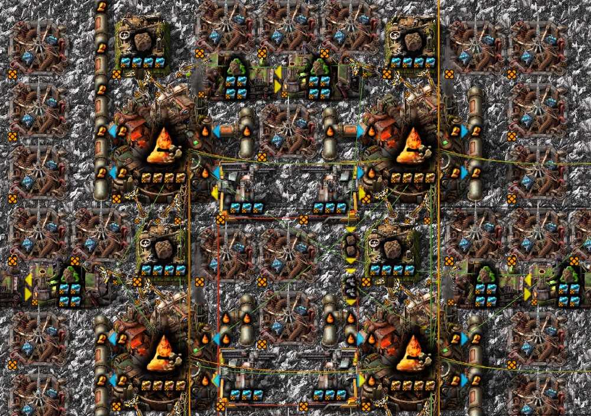
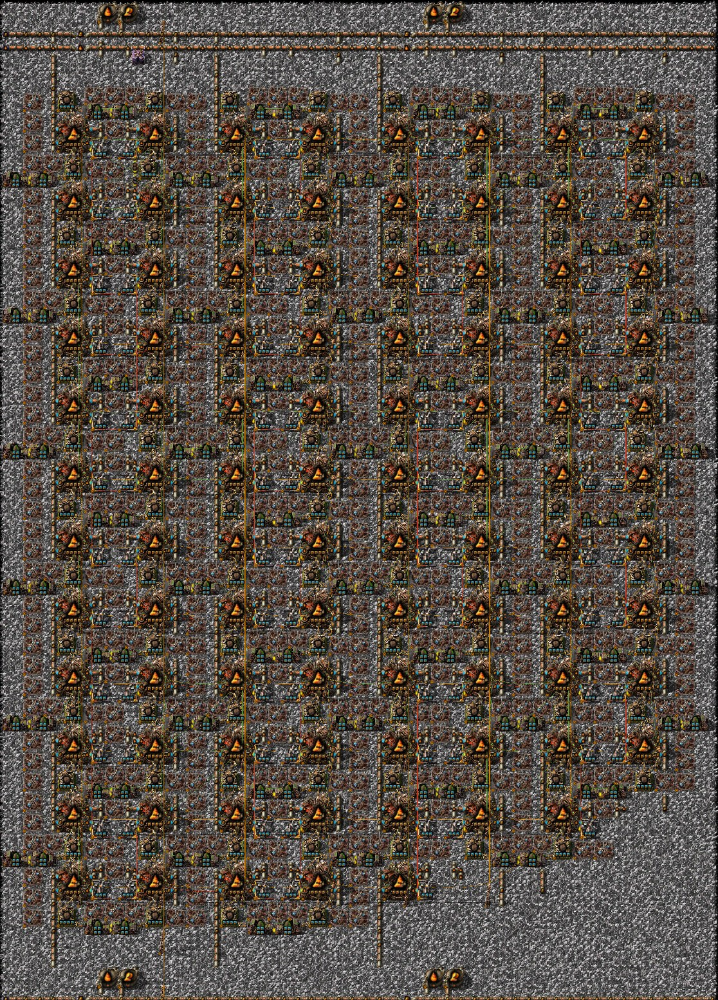
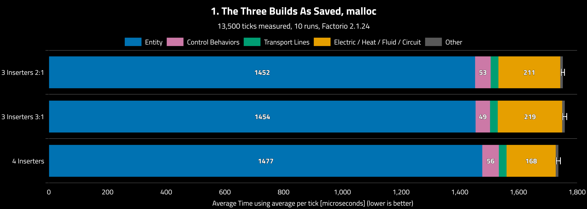
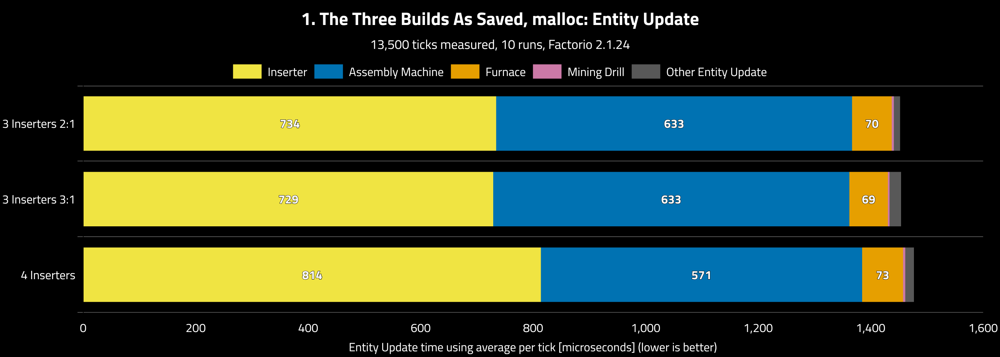
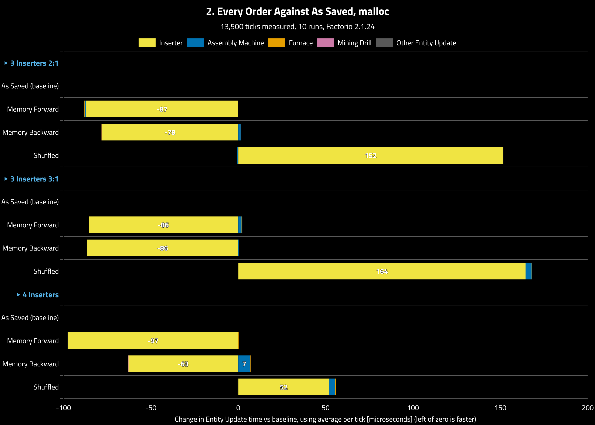
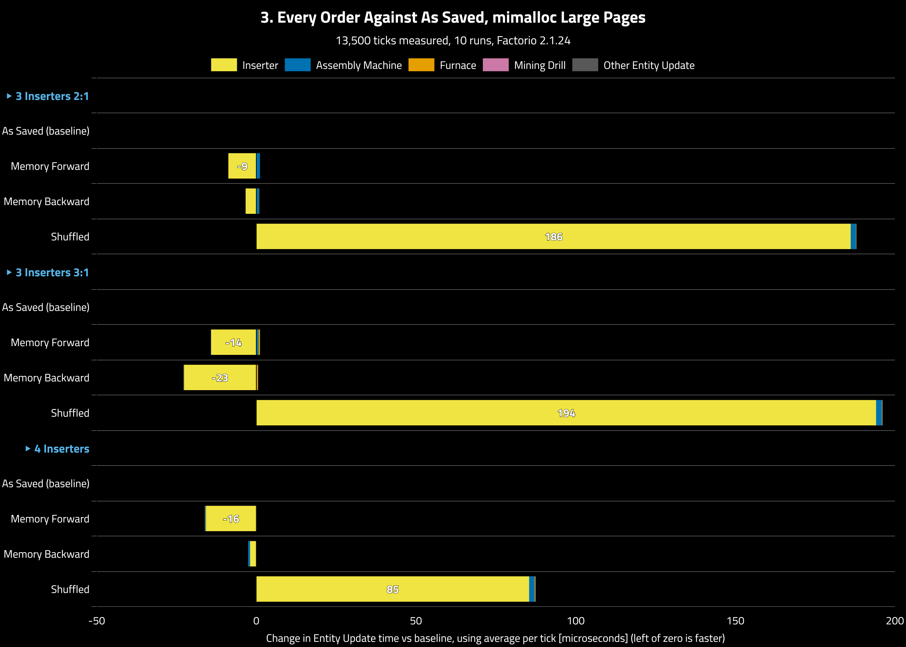
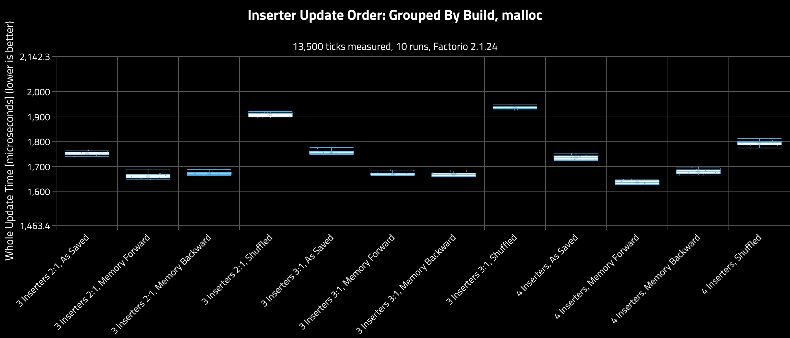
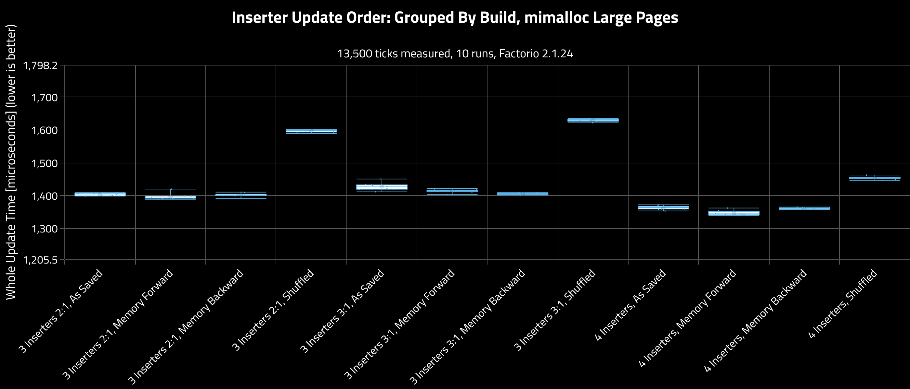

# Inserter Update Order

**Platform:** linux-x86_64

**Factorio Version:** 2.1.24

**Date:** 2026-11-02

**CPU:** Ryzen 9800X3D

**Coauthors:** atlan, Thaeln

## The Question
Which of three molten copper builds runs fastest? And can we even tell, when two copies of the same build can run at different speeds?

## The Answer
The answer depends on more than the build. Factorio updates active inserters in the order they became active, so each save carries an order from its own history, and that order costs memory time.

On Factorio's default memory allocator the three builds are within about 1% of each other as saved, 569 to 576 UPS, far less than the 5% each build's own saved order costs it. Give them all the same order and the 4-inserter build goes from slightly behind to 6% ahead, depending on which order. With mimalloc on large pages the saved order costs at most 1.6%, so the builds compare the same in any of these orders and the 4-inserter build leads by 3 to 5%. A scrambled order still costs up to 14% even then.

## Scenario
There are three community builds from members of abucnasty's discord, atlan and Thaeln, who contributed the save files. All make molten copper from lava on Vulcanus in 50 blocks, at equal output within 0.04%, with stone from each foundry carried by legendary stack inserters:

| Build | Foundries | Beacons a foundry | Stone inserters a foundry | Foundries an assembler |
|---|---|---|---|---|
| 3 Inserters 2:1 | 6,000 | 7 | 3 | 2 |
| 3 Inserters 3:1 | 6,000 | 7 | 3 | 3 |
| 4 Inserters | 4,600 | 10 | 4 | mostly 2 |

On the 4-inserter build, one hand of each four is set to 15. That carries 472.5 stone/s against 472.56 made, so the inserters never run short and output stays equal. Without it, 12.6% of hands need a second grab.

Foundries and their machines on the 4-inserter build, with beacons around them:



One of its 50 blocks:



Each build was saved in four update orders. Every save went through the same stop and restart, so none has a different history. The Lua commands are in the appendix.

| Save file | Order | What it does |
|---|---|---|
| `*-as-saved` | As Saved | Keeps the build's saved order |
| `*-memory-forward` | Memory Forward | The update walk runs forward through memory |
| `*-memory-backward` | Memory Backward | The update walk runs backward through memory |
| `*-shuffled` | Shuffled | Random order, fixed seed |

All 12 saves ran twice, in one session per allocator: glibc 2.43 malloc, the allocator Factorio uses by default on Linux (`benchmark_plain.sh`), and mimalloc on large pages (`benchmark_mimalloc.sh`). Each save ran for 15,000 ticks and 10 runs in random order, with the first 1,500 ticks trimmed, on built-in mods only with CPU boost off. Before timing, every order was checked near tick 14,000, and production, hands and swing phases were checked against As Saved.

## Results
All times are a relative reference from one machine.

### 1. As saved, they are close
The three builds as their saves left them, on glibc malloc. The 4-inserter build is about 1% faster than either 3-inserter build (576 UPS against 571 and 569), and the two 3-inserter builds can't be told apart. That gap is a fifth of what each build's own saved order costs it (about 5%), so a save with a different history could change the ranking.

The first chart splits the whole update into its top-level parts. The 4-inserter build's entity update is slightly the longest, and its lead is in electric, heat, fluid and circuit update: about 45 µs less, from 23% fewer foundries. The marks at the bar ends are 95% confidence intervals over the 10 runs: the two 3-inserter builds overlap, the 4-inserter build does not.



The second chart breaks entity update down by entity type. The 4-inserter build spends about 80 µs more on inserters and 60 µs less on machines.



### 2. On malloc, the order moves every build by about 5%
Each build's other three orders against its own As Saved save. Memory order, forward or backward, makes the whole update 3 to 6% faster, and shuffling makes it 3 to 10% slower. All of it is inserter time; machines don't move.

Because the effect differs by build, the order decides the ranking. In memory forward order the 4-inserter build leads by 1.5% (611 UPS against 602 and 598); shuffled, it leads by 6% (557 against 524 and 517). Shuffling adds 152 and 164 µs of inserter time to the 3-inserter builds but only 52 µs to the 4-inserter build, because about a quarter of its inserters always reload in build order (see "How the game orders inserters").



### 3. On mimalloc, the saved order barely matters
The same chart with mimalloc on large pages. Memory order now makes the whole update only 0.1 to 1.6% faster, so each build's saved order is nearly as good as memory order, and the builds compare the same whichever of these orders they carry: the 4-inserter build leads by 3 to 5%.

Shuffling still costs: 7 to 14%, more than on malloc. Large pages remove the cost of walking from one inserter to the next, not the cost of each inserter's work on scattered memory (see "Why the order costs time").



### 4. Every order against As Saved
| Build | Order | Whole update, malloc | Whole update, mimalloc | Inserter µs, malloc | Inserter µs, mimalloc |
|---|---|---|---|---|---|
| 3 Inserters 2:1 | Memory Forward | -5.2% | -0.6% | -87 | -9 |
| | Memory Backward | -4.5% | -0.1% | -78 | -3 |
| | Shuffled | +9.0% | +13.7% | +152 | +186 |
| 3 Inserters 3:1 | Memory Forward | -4.8% | -1.0% | -86 | -14 |
| | Memory Backward | -5.1% | -1.6% | -86 | -23 |
| | Shuffled | +10.1% | +14.1% | +164 | +194 |
| 4 Inserters | Memory Forward | -5.7% | -1.2% | -97 | -16 |
| | Memory Backward | -3.3% | -0.2% | -63 | -2 |
| | Shuffled | +3.4% | +6.6% | +52 | +85 |

Negative is faster. The charts for each allocator, grouped by order and by build, are in `charts_plain/` and `charts_mimalloc/`.

### 5. Run to run spread
Each box is the whole update of one save's 10 runs. On malloc the runs of a save spread by 6 to 12 µs (standard deviation), far less than the order effects, so every order clearly differs from As Saved. On mimalloc they spread by 2 to 11 µs, about the size of the differences between As Saved and memory order (2 to 23 µs), so those orders can't all be told apart; Shuffled still stands well clear.





## How the game orders inserters
Observed behaviour on these saves, not read from the game's source. Players cannot set this order; this test set it with a script, shown in the appendix.

- **One list, walked once a tick.** It holds active inserters only, so disabled ones are not visited.
- **Newest first.** An inserter joins at or near the front when it becomes active.
- **Stable until something leaves.** The order is kept in the save. An inserter that goes inactive rejoins elsewhere.
- **Not set by position or build order.** Inserters that activate together join together, so the next inserter shares a swing phase 99.4% of the time (56% by chance).
- **Loading can reorder part of it.** On the 4-inserter build, one inserter of each foundry is put first when a save loads, in reverse build order, whatever order the save held.

## Why the order costs time
Inserters sit in memory roughly in the order they were built, while the update list follows activation. The order then costs time in two ways.

**Walking from one inserter to the next.** Before updating an inserter, the game finds the next one in memory. On glibc malloc the memory sits on 4 KB pages, and a walk that keeps landing on new pages misses the processor's address translation cache. Across the profiled saves, the walk's cost ranks exactly with those misses. mimalloc puts the game's memory on 2 MB pages instead: all of a build's inserters fit in about 160 of them, and the misses disappear in every order.

**Each inserter's own work.** An inserter reads its own data and its machines. A scrambled order makes those reads cache-unfriendly, and large pages cannot fix that, so shuffling still costs on mimalloc.

Flat profiles of the 3 Inserters 2:1 build, one uProf run a save. Cycle samples are for comparing rows, not timings; 1,000 is roughly 10 µs a tick. The walk is inlined in `EntityOrderHelpers::EntityOrderList<...>`, and "Inserter functions" sums `Inserter::update()`, `Inserter::moveHandTo(...)` and the rest of `Inserter::`.

| Order | Allocator | Walk | Translation misses in it | Inserter functions | Cache refills in them |
|---|---|---|---|---|---|
| Memory Forward | glibc | 7,826 | 461 | 26,967 | 3,972 |
| As Saved | glibc | 16,309 | 1,412 | 25,330 | 6,770 |
| Shuffled | glibc | 15,220 | 1,273 | 34,128 | 6,618 |
| Memory Forward | mimalloc | 1,196 | 0 | 24,641 | 2,016 |
| As Saved | mimalloc | 1,379 | 0 | 25,093 | 3,542 |
| Shuffled | mimalloc | 1,233 | 0 | 35,861 | 4,769 |

## How this was worked out
Three builds at equal output came within 1.3% of each other, but the 4-inserter one spent 15% more on inserters. Partial grabs explained only about 21 of the 106 µs. A profiler placed the rest in walking between inserters, and visit counts ruled out extra work. Reading one tick's visit order pointed to activation order, so restarting inserters in a chosen order became the test, timed against lines written beforehand. The walk's cost then ranked exactly with 4 KB address translation misses, which predicted that large pages would remove the saved order's cost. They did, but shuffling still cost as much, which showed the second cost.

## Appendix: setting the inserter update order

The Lua used to build the saves in this folder. Each block is one console command: join its lines after `/sc`. This is a test tool for benchmarks. Players cannot set this order in normal play.

The commands were run by the tools' save editor on a paused headless game. Its helpers are replaced here: `__s` with `game.surfaces["nauvis"]`, and its result counter is left out. Nothing else changed.

### Steps
1. Run **Freeze**.
2. Run two ticks, so the frozen inserters leave the update list.
3. Run **Wake** for the order you want.
4. Save.

The As Saved saves went through the same steps. They wake in the reverse of their saved list, which was read beforehand with a debugger, so they keep their order and share the same history.

### Freeze
Takes every inserter that picks up from a foundry, 18,000 on the 3-inserter builds and 18,300 on the 4-inserter build, and stops them mid-swing. They all stop on the same tick, so their swing phases stay as they were.

```lua
local l = {}
for _, e in pairs(game.surfaces["nauvis"].find_entities_filtered({ type = "inserter" })) do
    local p = e.pickup_target
    if p and p.name == "foundry" then l[#l + 1] = e end
end
table.sort(l, function(a, b) return a.unit_number < b.unit_number end)
for _, e in ipairs(l) do e.disabled_by_script = true end
```

### Wake
Each save rebuilds the same list, in rising unit number, then wakes it in a chosen order. New activations go to the front of the update list, so the list ends up in the reverse of the wake order.

#### Memory forward
Wakes in falling unit number, so the update walk runs forward through memory.

```lua
local l = {}
for _, e in pairs(game.surfaces["nauvis"].find_entities_filtered({ type = "inserter" })) do
    local p = e.pickup_target
    if p and p.name == "foundry" then l[#l + 1] = e end
end
table.sort(l, function(a, b) return a.unit_number < b.unit_number end)
local n = #l
for i = 1, math.floor(n / 2) do l[i], l[n - i + 1] = l[n - i + 1], l[i] end
for _, e in ipairs(l) do e.disabled_by_script = false end
```

#### Memory backward
Wakes in rising unit number, so the update walk runs backward through memory.

```lua
local l = {}
for _, e in pairs(game.surfaces["nauvis"].find_entities_filtered({ type = "inserter" })) do
    local p = e.pickup_target
    if p and p.name == "foundry" then l[#l + 1] = e end
end
table.sort(l, function(a, b) return a.unit_number < b.unit_number end)
for _, e in ipairs(l) do e.disabled_by_script = false end
```

#### Shuffled
Wakes in a random order with a fixed seed, so it can be repeated.

```lua
local l = {}
for _, e in pairs(game.surfaces["nauvis"].find_entities_filtered({ type = "inserter" })) do
    local p = e.pickup_target
    if p and p.name == "foundry" then l[#l + 1] = e end
end
table.sort(l, function(a, b) return a.unit_number < b.unit_number end)
local r = game.create_random_generator(12345)
for i = #l, 2, -1 do
    local j = r(1, i)
    l[i], l[j] = l[j], l[i]
end
for _, e in ipairs(l) do e.disabled_by_script = false end
```

#### As Saved
Wakes in the reverse of the saved list, so the list comes back the same. `__o` holds the saved list's unit numbers, loaded by earlier commands.

```lua
local l = {}
for _, e in pairs(game.surfaces["nauvis"].find_entities_filtered({ type = "inserter" })) do
    local p = e.pickup_target
    if p and p.name == "foundry" then l[#l + 1] = e end
end
local m = {}
for _, e in ipairs(l) do m[e.unit_number] = e end
for i = #__o, 1, -1 do m[__o[i]].disabled_by_script = false end
```

### Check it worked
Sampled before timing, the saves of a build showed the same hands, swing phases and crafts once settled, and the order was still in place near tick 14,000. Freezing backs the foundries up for a moment, so trim the first ticks of a timed run. Here, 1,500 were trimmed, though the saves settle within a few hundred.

## Appendix: launchers
`benchmark_plain.sh` and `benchmark_mimalloc.sh` each run the saves through one launcher in `launchers/`, so the allocator is the only difference. Each then runs `belt-charts prune --keep-only-charted --compress zst` on its per-tick results, which keeps only the columns the charts read and stores them as `.csv.zst` (about an eighth of the size); belt-charts reads those directly, and `zstd -d` turns them back into plain CSV.

- `factorio-2.1.24` runs the game as it is, on glibc malloc.
- `factorio-2.1.24-mimalloc` preloads mimalloc v3.6.1, the official prebuilt release (https://github.com/microsoft/mimalloc/releases/tag/v3.6.1, `lib/libmimalloc.so`), with `MIMALLOC_ALLOW_LARGE_OS_PAGES=1` and `MIMALLOC_PURGE_DELAY=-1`. With no huge pages reserved it uses transparent 2 MB pages; on the test machine 99.7% of the game's memory was on them, against none for glibc malloc. Set `MIMALLOC_SO` if it is installed elsewhere.

`./charts.sh` draws every chart listed in `charts.json`: the comparisons above, and each session's charts grouped by order and by build (`charts_plain/`, `charts_mimalloc/`). It needs belt-charts 1.25.0 or newer, and Node.js 22.15 or newer to read `.csv.zst`.
